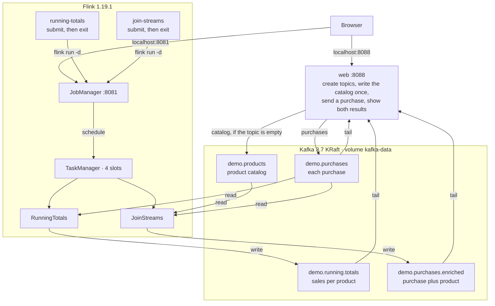
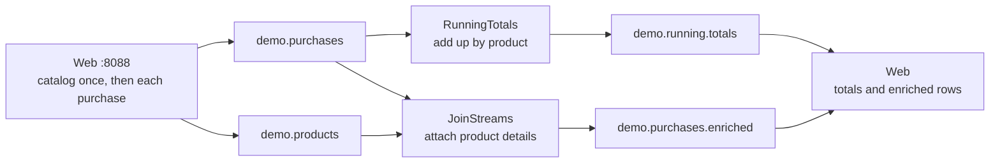
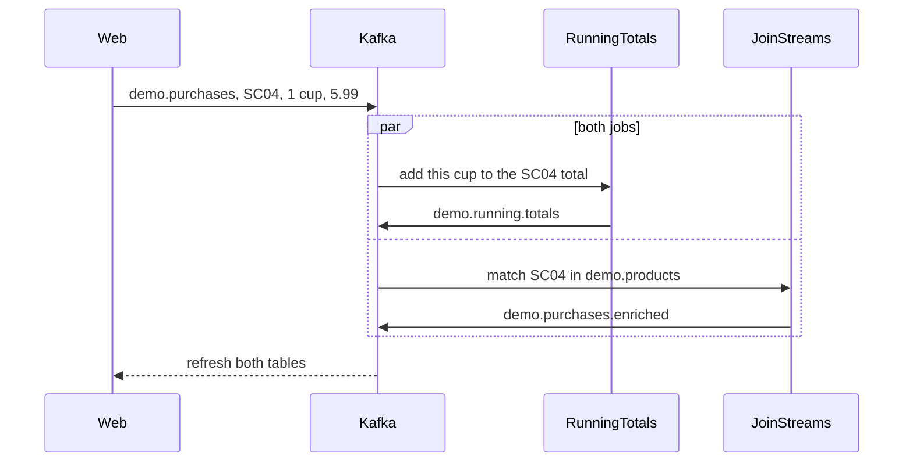
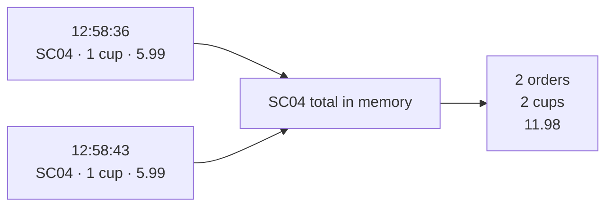

# Apache Flink / Apache Kafka Streaming Analytics Demo

A Java demo with two streaming scenarios. The sales scenario uses two Flink jobs to keep running totals and enrich purchases. The A/B testing scenario uses a third job to validate, deduplicate, attribute, and aggregate tracking events.

The product catalog follows the [Streaming Synthetic Sales Data Generator](https://github.com/garystafford/streaming-sales-generator). The Docker Compose stack includes Kafka 3.7 (KRaft), Flink 1.19.1, Spring Boot, PostgreSQL, and ClickHouse.

> 项目同时包含销售分析和 A/B 测试两条数据链路。整体数据模型、节点职责和端到端流转见
> [数据模型与端到端数据流](docs/data-model-and-flow.md)。

## Sales demo architecture

The following diagram focuses on the sales scenario. See [数据模型与端到端数据流](docs/data-model-and-flow.md) for the complete stack, including the A/B pipeline.

Kafka stores the messages and Flink computes them. `running-totals` and `join-streams` submit one job each and then exit. The submitted programs keep running on the TaskManager.



| Piece | Lifetime | What it does |
| --- | --- | --- |
| `kafka` | stays up | KRaft broker. Compose uses `kafka:29092`. The host uses `localhost:9092`. |
| `web` | stays up | Spring Boot app. Creates all eight topics: four sales and four A/B topics. Writes the catalog to `demo.products` only when that topic is empty. Writes each purchase to `demo.purchases`. Tails that topic plus the two sales result topics for the page. |
| `jobmanager` | stays up | Accepts job submissions. Flink UI on port 8081. |
| `taskmanager` | stays up | Runs all three Flink jobs. Four task slots. |
| `running-totals` | exits | Submits `org.example.RunningTotals` with `flink run -d`, then exits. Skips the submit when that job name is already running. |
| `join-streams` | exits | Submits `org.example.JoinStreams` the same way. |
| `event-analytics` | exits | Submits `org.example.ab.EventAnalyticsJob` for the A/B pipeline, then exits. |
| `RunningTotals` | stays up on the TaskManager | Reads `demo.purchases`. Keeps one total per product. Writes `demo.running.totals`. |
| `JoinStreams` | stays up on the TaskManager | Reads `demo.products` and `demo.purchases`. Writes `demo.purchases.enriched`. |
| `EventAnalyticsJob` | stays up on the TaskManager | Reads raw A/B events. Validates, deduplicates, attributes, and writes valid events and minute metrics. |

One purchase is handled by both jobs at the same time. The page refreshes from the two result topics, and also tails `demo.purchases` so the sent row shows up before Flink finishes.

## What you are looking at

The web app sends a purchase. Kafka holds it. Flink updates two results, and the web app shows both.



| Job | Reads | Writes |
| --- | --- | --- |
| `org.example.RunningTotals` | `demo.purchases` | `demo.running.totals` — transaction count, quantity, and sales per product |
| `org.example.JoinStreams` | `demo.products`, `demo.purchases` | `demo.purchases.enriched` — each purchase plus product name, category, and cost |

One purchase is handled by both jobs at the same time:



`RunningTotals` does not scan old orders. It keeps one total per product and adds the new cup to it:



| Time | New purchase | SC04 total after this purchase |
| --- | --- | --- |
| 12:58:36 | 1 cup, 5.99 | 1 order / 1 cup / 5.99 |
| 12:58:43 | 1 cup, 5.99 | 2 orders / 2 cups / 11.98 |

## Learn

Longer beginner notes, in Chinese, with more diagrams:

* [数据模型与端到端数据流](docs/data-model-and-flow.md) — 两条链路的数据模型、处理节点、状态语义和指标口径总览
* [统计销量，为什么不直接用数据库？](docs/database-vs-flink.md) — the same sales question, answered with a database query or with this pipeline
* [Flink 怎么读 Kafka](docs/flink-kafka-topology.md) — how one purchase moves from a topic to a running total
* [埋点与 A/B 测试 MVP](docs/ab-testing-mvp.md) — SDK、API、Topic 和指标定义

## Quick start

Requires Docker Compose. One command starts the complete stack:

```shell
docker compose up --build -d
```

That starts PostgreSQL, ClickHouse, Kafka, the web app, and Flink; writes the product catalog once when `demo.products` is empty; and submits all three Flink jobs.

- Web: <http://localhost:8088> — send a purchase and watch the totals
- A/B demo: <http://localhost:8088/ab-demo.html> — stable assignment and tracked conversion
- A/B dashboard: <http://localhost:8088/ab-dashboard.html> — experiments, recent events, and metrics
- Flink UI: <http://localhost:8081>
- Kafka from the host: `localhost:9092`

The Compose stack also starts PostgreSQL for experiment configuration and ClickHouse for event
analytics. See [埋点与 A/B 测试 MVP](docs/ab-testing-mvp.md) for the SDK, API, and metric definitions.

Inside the Compose network, jobs use `kafka:29092`. `BOOTSTRAP_SERVERS` on the job containers overrides `flink-jobs/src/main/resources/config.properties`.

```shell
# running totals written by org.example.RunningTotals
docker compose exec kafka /opt/bitnami/kafka/bin/kafka-console-consumer.sh \
  --topic demo.running.totals --from-beginning --bootstrap-server localhost:9092

# enriched purchases written by org.example.JoinStreams
docker compose exec kafka /opt/bitnami/kafka/bin/kafka-console-consumer.sh \
  --topic demo.purchases.enriched --from-beginning --bootstrap-server localhost:9092

docker compose down
```

Send purchases from the web app. The web app seeds the catalog when `demo.products` is empty. Point `BOOTSTRAP_SERVERS` at another broker if you want the same jobs to read an existing Kafka cluster.

After a code change, rebuild and submit again:

```shell
docker compose up --build -d
```

The submit containers skip a job that is already running under the same name. Cancel it in the Flink UI first if you need a fresh submission.

The two sales sinks use `AT_LEAST_ONCE`, so recovery can produce duplicate output. Messages on `demo.running.totals` are successive cumulative snapshots; do not add them together as if they were deltas.

## Message samples

Purchase on `demo.purchases`:

```json
{"transaction_time":"2026-11-06 07:10:00.000000","transaction_id":"1793949000000-a1b2c3d4","product_id":"SC04","price":5.99,"quantity":1,"is_member":false,"member_discount":0.00,"add_supplements":false,"supplement_price":0.00,"total_purchase":5.99}
```

Running total on `demo.running.totals` after many purchases, not just the two cups above:

```json
{"event_time":"2026-11-06 07:10:00.000000","product_id":"SC04","transactions":52,"quantities":65,"sales":432.06}
```

Enriched purchase on `demo.purchases.enriched`. The purchase only carried `product_id`; the name and category came from `demo.products`:

```json
{"transaction_time":"2026-11-06 07:10:00.000000","transaction_id":"1793949000000-a1b2c3d4","product_id":"SC04","product_category":"Supercharged Smoothies","product_name":"Health Nut","product_size":"24 oz.","product_cogs":2.70,"product_price":5.99,"contains_fruit":false,"contains_veggies":false,"contains_nuts":true,"contains_caffeine":false,"purchase_price":5.99,"purchase_quantity":1,"is_member":false,"member_discount":0.00,"add_supplements":false,"supplement_price":0.00,"total_purchase":5.99}
```

## Flink UI

Open <http://localhost:8081> to inspect all three jobs, their operators, checkpoints, and failures.

Short [YouTube video](https://youtu.be/ja0M_2zdbfs) of the original sales demo (video only, no audio).

## Kafka commands

```shell
export BOOTSTRAP_SERVERS="localhost:9092"

docker compose exec kafka /opt/bitnami/kafka/bin/kafka-topics.sh \
  --list --bootstrap-server $BOOTSTRAP_SERVERS

docker compose exec kafka /opt/bitnami/kafka/bin/kafka-topics.sh \
  --topic demo.running.totals \
  --describe \
  --bootstrap-server $BOOTSTRAP_SERVERS

docker compose exec kafka /opt/bitnami/kafka/bin/kafka-console-consumer.sh \
  --topic demo.purchases --from-beginning \
  --bootstrap-server $BOOTSTRAP_SERVERS
```

Topics are created by the web app on startup:

- Sales: `demo.products`, `demo.purchases`, `demo.purchases.enriched`, `demo.running.totals`;
- A/B: `ab.events.raw`, `ab.events.valid`, `ab.events.dlq`, `ab.metrics.1m`.

## Build the jar on the host

Compose builds the uber JAR inside the job image. To build it locally, use JDK 17 (the Flink module still targets Java 11):

```shell
mvn -B -pl flink-jobs -am package -DskipTests
```

The JAR is `flink-jobs/target/flink-kafka-demo-1.2.0-all.jar`. Flink dependencies are `provided` and must match the Flink 1.19.1 cluster.

## References

* <https://www.baeldung.com/kafka-flink-data-pipeline>
* <https://github.com/eugenp/tutorials/tree/master/apache-kafka/src/main/java/com/baeldung/flink>
* <https://github.com/apache/flink/blob/master/flink-examples/flink-examples-table/src/main/java/org/apache/flink/table/examples/java/basics/StreamSQLExample.java>

---

_The contents of this repository represent my viewpoints and not of my past or current employers, including Amazon Web
Services (AWS). All third-party libraries, modules, plugins, and SDKs are the property of their respective owners. The
author(s) assumes no responsibility or liability for any errors or omissions in the content of this site. The
information contained in this site is provided on an "as is" basis with no guarantees of completeness, accuracy,
usefulness or timeliness._
