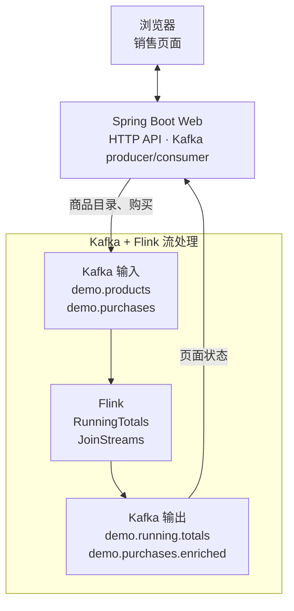
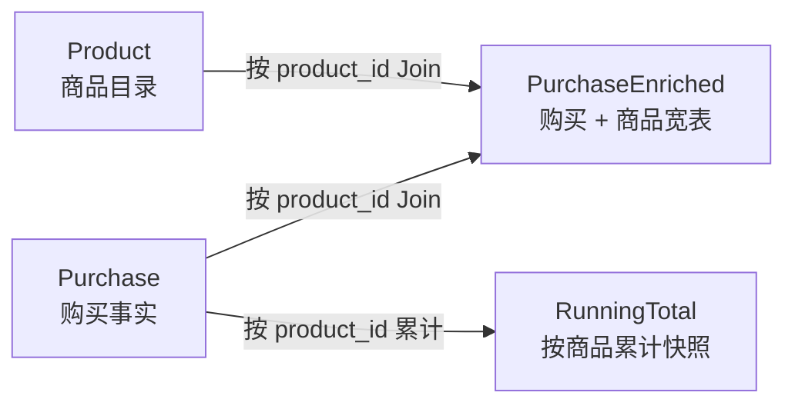
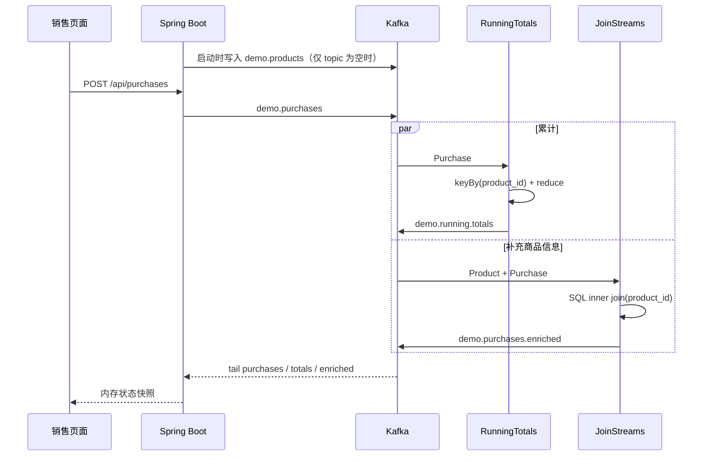

# 数据模型与端到端数据流

本文是项目的数据架构总览，帮助新读者快速回答三个问题：

1. 系统里有哪些数据；
2. 数据经过哪些组件、发生了什么变化；
3. 页面最终展示的是哪一种结果。

项目是一条销售分析链路：演示按商品累计销售额，以及购买记录与商品目录的流式 Join。

## 1. 全局架构

销售结果回到 Web 内存供页面展示。

组件分工：

| 组件 | 职责 | 是否保存业务数据 |
| --- | --- | --- |
| 浏览器 | 发送购买、展示累计和关联结果 | 否 |
| Spring Boot Web | 创建 topic、生产/消费 Kafka 消息、提供页面状态 | 销售页面状态只保存在内存 |
| Kafka | 解耦生产和计算，保存购买、目录和计算结果 | 是，按 topic 保留消息 |
| Flink | 按商品累计，并把购买记录与商品目录 Join | 是，算子状态通过 checkpoint 持久化 |

Compose 默认以单机演示方式运行：Kafka 单 Broker，Flink 单 JobManager、单 TaskManager（4 slots），默认并行度为 1。两个提交容器把作业提交给 JobManager 后退出，作业继续在 Flink 集群中运行。

## 2. 数据模型分层

### 2.1 销售链路模型

#### Product：商品维度

来源为 `catalog.json`，Web 应用仅在 `demo.products` 为空时写入一次。

| 字段组 | 主要字段 | 含义 |
| --- | --- | --- |
| 标识 | `product_id` | 商品业务键，也是 Join 键 |
| 描述 | `category`、`item`、`size` | 商品分类、名称和规格 |
| 金额 | `cogs`、`price` | 成本和目录售价 |
| 库存/标签 | `inventory_level`、`contains_*`、`propensity_to_buy` | 演示用商品属性 |

#### Purchase：购买事实

由 `POST /api/purchases` 生成并写入 `demo.purchases`。

| 字段组 | 主要字段 | 含义 |
| --- | --- | --- |
| 标识和时间 | `transaction_id`、`transaction_time` | 交易 ID 和发生时间 |
| 商品和数量 | `product_id`、`price`、`quantity` | 商品键、成交单价和件数 |
| 优惠 | `is_member`、`member_discount` | 会员标记和折扣 |
| 金额 | `supplement_price`、`total_purchase` | 加料金额和该笔实付金额 |

`product_name` 只用于 Web 响应，写 Kafka 前会移除；下游名称来自商品目录 Join。

#### RunningTotal：累计快照

`RunningTotals` 按 `product_id` 保存状态。每收到一笔购买，就输出该商品截至当前的最新累计快照：

| 字段 | 计算 |
| --- | --- |
| `event_time` | 当前到达的购买时间 |
| `product_id` | 聚合键 |
| `transactions` | 购买记录数累计 |
| `quantities` | 购买件数累计 |
| `sales` | `total_purchase` 累计 |

它不是单笔增量，也不是数据库中唯一的一行；`demo.running.totals` 会保留连续产生的多个快照。

#### PurchaseEnriched：购买宽表

`JoinStreams` 按 `product_id` 对 `Product` 与 `Purchase` 做内连接，输出购买字段及商品名称、分类、规格、成本和标签。商品目录缺少对应键时，该购买不会产生 enriched 结果。

## 3. 数据如何流转和处理

这条链路不使用事件时间窗口和 watermark。两个 sink 均为 `AT_LEAST_ONCE`，故障恢复边界可能出现重复结果；消费累计 topic 时应把消息理解为“快照流”，而不是可直接求和的增量流。

## 4. Topic 与生产消费关系

| Topic | 分区 | 生产者 | 消费者 | 数据模型 |
| --- | ---: | --- | --- | --- |
| `demo.products` | 1 | Web bootstrap | `JoinStreams` | Product |
| `demo.purchases` | 1 | Web purchase API | `RunningTotals`、`JoinStreams`、Web listener | Purchase |
| `demo.running.totals` | 1 | `RunningTotals` | Web listener | RunningTotal |
| `demo.purchases.enriched` | 1 | `JoinStreams` | Web listener | PurchaseEnriched |

所有消息均为 JSON 文本；项目未使用 Schema Registry、Avro 或 Protobuf。

## 5. 关键设计边界与注意事项

1. **Join 是普通流式内连接**：商品流并非显式 temporal table，目录更新和消息重放会影响 Join 状态及输出。
2. **销售 sink 为至少一次**：下游应容忍重复；累计消息是连续快照。
3. **演示环境不是高可用部署**：Kafka 为单节点，topic 副本数为 1。

## 6. 代码导航

| 主题 | 关键文件 |
| --- | --- |
| 容器和运行拓扑 | `docker-compose.yml` |
| Topic 配置和创建 | `sales-web/src/main/resources/application.yml`、`sales-web/src/main/java/org/example/web/KafkaSetup.java` |
| 销售消息生成 | `sales-web/src/main/java/org/example/web/PurchaseMessages.java` |
| 销售 Flink 作业 | `flink-jobs/src/main/java/org/example/RunningTotals.java`、`JoinStreams.java` |
| 销售 Flink 模型 | `flink-jobs/src/main/java/org/example/model/` |

阅读顺序建议：先看本文的全局架构和流转图，再进入销售链路的具体实现。
