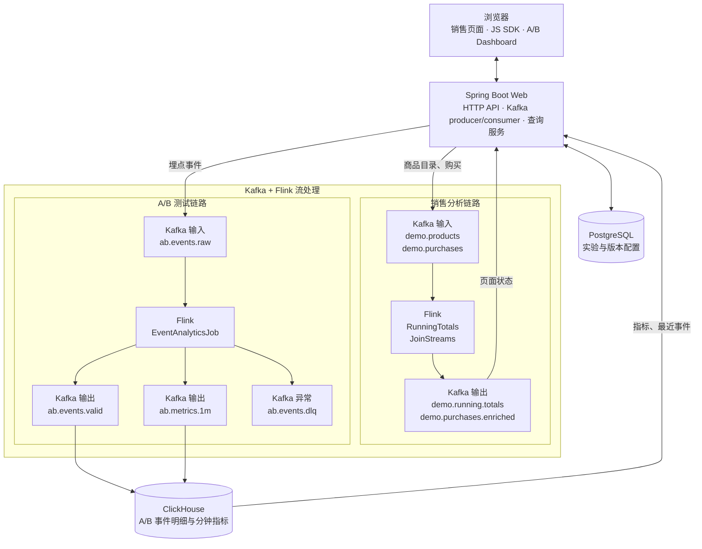
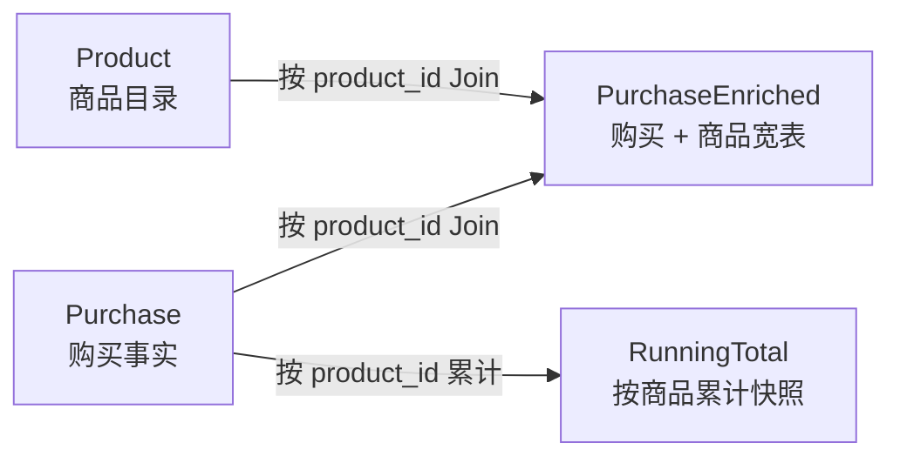
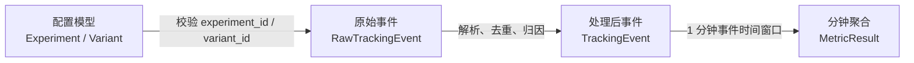
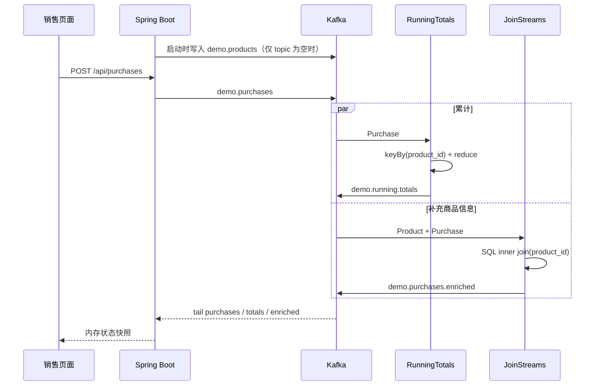
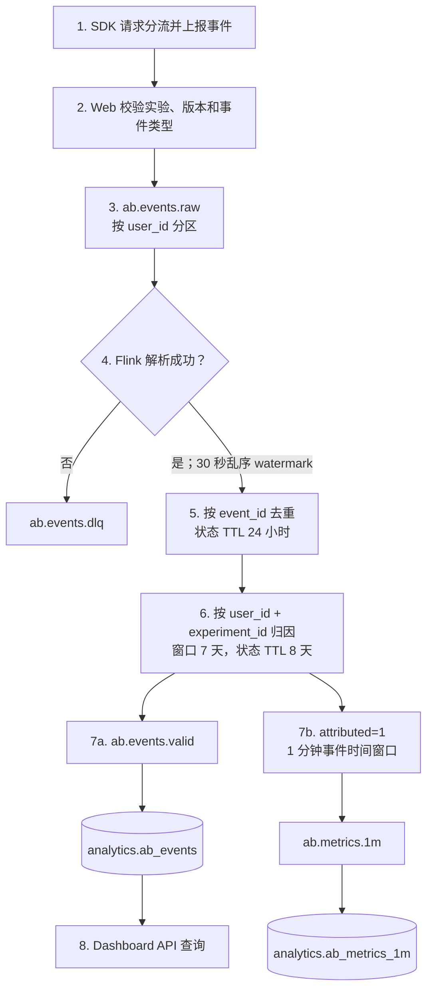

# 数据模型与端到端数据流

本文是项目的数据架构总览，帮助新读者快速回答三个问题：

1. 系统里有哪些数据；
2. 数据经过哪些组件、发生了什么变化；
3. 最终查询采用什么口径。

项目包含两条彼此独立、但共用 Kafka、Flink 和 Web 应用的链路：

- **销售分析 Demo**：演示按商品累计销售额，以及购买记录与商品目录的流式 Join；
- **A/B 测试 MVP**：演示实验分流、埋点接入、事件校验、去重、归因、分钟聚合和分析查询。

## 1. 全局架构

图按“接入层 → 两条流处理链路 → 查询存储”阅读。销售结果回到 Web
内存供页面展示；A/B 结果进入 ClickHouse 后由 Web 查询，DLQ 仅用于人工排查。

组件分工：

| 组件 | 职责 | 是否保存业务数据 |
| --- | --- | --- |
| 浏览器 / JS SDK | 请求实验版本、渲染版本、上报曝光/点击/购买 | `localStorage` 保存匿名用户 ID，`sessionStorage` 保存会话和曝光标记 |
| Spring Boot Web | 创建 topic、校验请求、生产/消费 Kafka 消息、提供查询 API | 销售页面状态只保存在内存 |
| PostgreSQL | 保存实验、版本、权重、流量和版本 payload | 是，实验配置的事实来源 |
| Kafka | 解耦生产、计算和存储节点，保存原始事件及计算结果 | 是，按 topic 保留消息 |
| Flink | 累计、Join、事件校验、去重、归因和窗口聚合 | 是，算子状态通过 checkpoint 持久化 |
| ClickHouse | 保存 A/B 有效事件和分钟指标，支持分析查询 | 是，A/B 分析数据的查询存储 |

Compose 默认以单机演示方式运行：Kafka 单 Broker，Flink 单 JobManager、单 TaskManager（4 slots），默认并行度为 1。三个提交容器把作业提交给 JobManager 后退出，作业继续在 Flink 集群中运行。

## 2. 数据模型分层

### 2.1 销售链路模型

#### Product：商品维度

来源为 `catalog.json`，Web 应用仅在 `demo.products` 为空时写入一次。

| 字段组 | 主要字段 | 含义 |
| --- | --- | --- |
| 标识 | `product_id` | 商品业务键，也是 Join 键 |
| 描述 | `category`、`item`、`size` | 商品分类、名称和规格 |
| 金额 | `cogs`、`price` | 成本和目录售价 |
| 库存/标签 | `inventory_level`、`contains_*`、`propensity_to_buy` | 演示用商品属性 |

#### Purchase：购买事实

由 `POST /api/purchases` 生成并写入 `demo.purchases`。

| 字段组 | 主要字段 | 含义 |
| --- | --- | --- |
| 标识和时间 | `transaction_id`、`transaction_time` | 交易 ID 和发生时间 |
| 商品和数量 | `product_id`、`price`、`quantity` | 商品键、成交单价和件数 |
| 优惠 | `is_member`、`member_discount` | 会员标记和折扣 |
| 金额 | `supplement_price`、`total_purchase` | 加料金额和该笔实付金额 |

`product_name` 只用于 Web 响应，写 Kafka 前会移除；下游名称来自商品目录 Join。

#### RunningTotal：累计快照

`RunningTotals` 按 `product_id` 保存状态。每收到一笔购买，就输出该商品截至当前的最新累计快照：

| 字段 | 计算 |
| --- | --- |
| `event_time` | 当前到达的购买时间 |
| `product_id` | 聚合键 |
| `transactions` | 购买记录数累计 |
| `quantities` | 购买件数累计 |
| `sales` | `total_purchase` 累计 |

它不是单笔增量，也不是数据库中唯一的一行；`demo.running.totals` 会保留连续产生的多个快照。

#### PurchaseEnriched：购买宽表

`JoinStreams` 按 `product_id` 对 `Product` 与 `Purchase` 做内连接，输出购买字段及商品名称、分类、规格、成本和标签。商品目录缺少对应键时，该购买不会产生 enriched 结果。

### 2.2 A/B 链路模型

A/B 数据分为三层：

#### 实验配置：PostgreSQL

`experiments` 保存实验级配置：

- `id`：埋点中的 `experiment_id`；
- `experiment_key`：SDK 请求分流使用的稳定业务键；
- `status`：`DRAFT`、`RUNNING` 或 `PAUSED`；
- `salt`：稳定哈希盐；
- `traffic_percent`：进入实验的流量百分比；
- `created_at`、`updated_at`：配置时间。

`experiment_variants` 保存版本：

- `id`：埋点中的 `variant_id`；
- `experiment_id`：所属实验；
- `variant_key`、`name`：版本键和名称；
- `weight`：版本流量权重；
- `payload_json`：下发给前端的版本配置。

分流使用 `SHA-256(experimentKey:userId:salt)`。配置不变时，同一用户会稳定进入同一版本。PostgreSQL 只负责配置和分流，不存埋点事件。

#### 原始事件：API 与 `ab.events.raw`

标准事件只允许 `exposure`、`click`、`purchase`：

| 字段 | 必填 | 含义 |
| --- | --- | --- |
| `event_id` | 是 | UUID，Flink 去重键 |
| `event_name` | 是 | 标准事件名 |
| `event_time` | 是 | 客户端业务事件时间，ISO-8601 |
| `user_id` | 是 | 用户标识，同时是 Kafka message key |
| `session_id` | 否 | 会话标识 |
| `experiment_id` | 是 | 实验 UUID |
| `variant_id` | 是 | 版本 UUID |
| `properties` | 否 | JSON 扩展属性；购买金额取 `amount` |
| `sdk_version`、`page_url` | 否 | SDK 和页面上下文 |
| `received_at` | 服务端生成 | Web 服务接收时间 |

Web 服务在写入 Kafka 前检查：事件类型受支持、实验正在运行、版本属于该实验。单次 API 请求最多接收 100 条事件。

#### 处理后事件：`ab.events.valid` 与 `analytics.ab_events`

Flink 输出字段：

| 字段 | 变化或用途 |
| --- | --- |
| `event_id`、用户/实验/版本字段 | 从 raw 透传 |
| `event_time`、`received_at` | 转为 UTC `yyyy-MM-dd HH:mm:ss.SSS` |
| `properties` | 从 JSON 对象转为 JSON 文本字符串 |
| `attributed` | Flink 归因结果，`0` 或 `1` |
| `version` | `received_at` 的 epoch 毫秒，用于 ClickHouse 替换版本 |

`sdk_version`、`page_url` 不会进入 valid topic，因此 ClickHouse 中也没有这两个字段。解析失败的数据写入 `ab.events.dlq`，结构为 `raw`、`error`、`failed_at`。

ClickHouse 目标表 `analytics.ab_events` 使用：

- `ReplacingMergeTree(version)`；
- 按 `toYYYYMM(event_time)` 分区；
- 按 `(experiment_id, variant_id, event_time, event_id)` 排序；
- 查询侧使用 `FINAL` 合并同排序键的版本；
- 当前未配置 TTL。

#### 分钟指标：`ab.metrics.1m` 与 `analytics.ab_metrics_1m`

只对 `attributed = 1` 的事件，按 `(experiment_id, variant_id)` 进入 1 分钟滚动事件时间窗口：

| 字段 | 含义 |
| --- | --- |
| `window_start`、`window_end` | 窗口边界 |
| `experiment_id`、`variant_id` | 聚合维度 |
| `exposures`、`clicks`、`purchases` | 窗口内事件条数，不是 UV |
| `revenue` | purchase 的 `properties.amount` 之和 |
| `version` | 窗口结束时间的 epoch 毫秒 |

表 `analytics.ab_metrics_1m` 同样使用 `ReplacingMergeTree(version)`，按月分区，并以 `(experiment_id, variant_id, window_start)` 排序。

## 3. 数据如何流转和处理

### 3.1 销售链路

销售链路不使用事件时间窗口和 watermark。两个 sink 均为 `AT_LEAST_ONCE`，故障恢复边界可能出现重复结果；消费累计 topic 时应把消息理解为“快照流”，而不是可直接求和的增量流。

### 3.2 A/B 链路

处理规则如下：

1. **解析和校验格式**：检查必填字段、三个 UUID、事件名和 ISO 时间；错误进入 DLQ。
2. **事件时间**：采用 `event_time`，允许 30 秒乱序；输入空闲 1 分钟后标记 idle，避免阻塞全局 watermark。
3. **去重**：按 `event_id` 保存 24 小时 Flink 状态。同一 ID 在 TTL 到期后再次出现，仍可能被重新处理。
4. **曝光归因**：
   - 同一用户和实验的首个曝光标记为 `attributed = 1`；
   - 7 天内后续曝光标记为 `0`，但会更新“最近曝光”状态；
   - click/purchase 必须不早于最近曝光、间隔不超过 7 天，且 `variant_id` 相同，才标记为 `1`。
5. **输出**：全部成功解析且去重后的事件进入 valid；只有 `attributed = 1` 的事件进入分钟聚合。
6. **落库**：ClickHouse Kafka Engine 消费 valid/metrics topic，物化视图把消息写入 MergeTree 目标表。

A/B 作业显式启用 30 秒 checkpoint，Kafka sink 使用 `EXACTLY_ONCE` 和事务 ID 前缀。Flink 到 Kafka 的输出具备 checkpoint 协调的精确一次语义；ClickHouse 侧再通过 `ReplacingMergeTree(version)` 和查询 `FINAL` 处理版本合并。

## 4. 查询口径

A/B Dashboard 的指标 API **不读取** `analytics.ab_metrics_1m`，而是从 `analytics.ab_events FINAL` 实时计算：

| 指标 | 口径 |
| --- | --- |
| 曝光用户数 | `attributed=1` 的 exposure 用户去重数 |
| 点击用户数 | `attributed=1` 的 click 用户去重数 |
| 购买用户数 | `attributed=1` 的 purchase 用户去重数 |
| CTR | 点击用户数 / 曝光用户数 |
| 转化率 | 购买用户数 / 曝光用户数 |
| 订单数 | 已归因 purchase 事件条数 |
| GMV | 已归因 purchase 的 `properties.amount` 之和 |

因此存在两套有意不同的统计粒度：

- `ab_metrics_1m` 是**事件数分钟聚合**，适合时序监控和快速汇总；
- Dashboard 是从事件明细计算的**用户数指标**，用于实验效果分析。

二者不能直接逐项比较，尤其是 `clicks` 与“点击用户数”、`purchases` 与“购买用户数”。

## 5. Topic 与生产消费关系

| Topic | 分区 | 生产者 | 消费者 | 数据模型 |
| --- | ---: | --- | --- | --- |
| `demo.products` | 1 | Web bootstrap | `JoinStreams` | Product |
| `demo.purchases` | 1 | Web purchase API | `RunningTotals`、`JoinStreams`、Web listener | Purchase |
| `demo.running.totals` | 1 | `RunningTotals` | Web listener | RunningTotal |
| `demo.purchases.enriched` | 1 | `JoinStreams` | Web listener | PurchaseEnriched |
| `ab.events.raw` | 4 | Tracking API | `EventAnalyticsJob` | RawTrackingEvent |
| `ab.events.valid` | 4 | `EventAnalyticsJob` | ClickHouse Kafka Engine | TrackingEvent |
| `ab.events.dlq` | 4 | `EventAnalyticsJob` | 人工排查 | Invalid event |
| `ab.metrics.1m` | 4 | `EventAnalyticsJob` | ClickHouse Kafka Engine | MetricResult |

所有消息均为 JSON 文本；项目未使用 Schema Registry、Avro 或 Protobuf。

## 6. 关键设计边界与注意事项

1. **两条链路互相独立**：销售数据不会进入 PostgreSQL 或 ClickHouse；A/B 数据不会参与销售累计和 Join。
2. **Join 是普通流式内连接**：商品流并非显式 temporal table，目录更新和消息重放会影响 Join 状态及输出。
3. **销售 sink 为至少一次**：下游应容忍重复；累计消息是连续快照。
4. **A/B 字段会在阶段间变化**：时间格式被改写，`properties` 从对象变成字符串，`sdk_version` 和 `page_url` 被丢弃。
5. **去重和归因时长不同**：去重状态 24 小时，归因窗口 7 天；24 小时后重放相同 `event_id` 可能再次参与归因和统计。
6. **ClickHouse 没有 TTL**：数据会持续增长；生产化前应按保留策略补充 TTL 和容量规划。
7. **必须明确指标粒度**：分钟表统计事件数，Dashboard 统计 UV；新增查询前应先选择权威口径。
8. **演示环境不是高可用部署**：Kafka 和数据库均为单节点、topic 副本数为 1。

## 7. 代码导航

| 主题 | 关键文件 |
| --- | --- |
| 容器和运行拓扑 | `docker-compose.yml` |
| Topic 配置和创建 | `sales-web/src/main/resources/application.yml`、`sales-web/src/main/java/org/example/web/KafkaSetup.java` |
| 销售消息生成 | `sales-web/src/main/java/org/example/web/PurchaseMessages.java` |
| 销售 Flink 作业 | `flink-jobs/src/main/java/org/example/RunningTotals.java`、`JoinStreams.java` |
| 销售 Flink 模型 | `flink-jobs/src/main/java/org/example/model/` |
| 实验配置模型 | `sales-web/src/main/resources/db/migration/V1__experiments.sql` |
| 埋点 API 模型和接入 | `sales-web/src/main/java/org/example/web/tracking/` |
| A/B Flink 作业 | `flink-jobs/src/main/java/org/example/ab/EventAnalyticsJob.java` |
| ClickHouse 表和摄入 | `docker/clickhouse/init/001_ab_analytics.sql` |
| Dashboard 查询口径 | `sales-web/src/main/java/org/example/web/analytics/AnalyticsRepository.java` |

阅读顺序建议：先看本文的全局架构和两条流转图，再根据关注点进入销售或 A/B 的具体实现。
